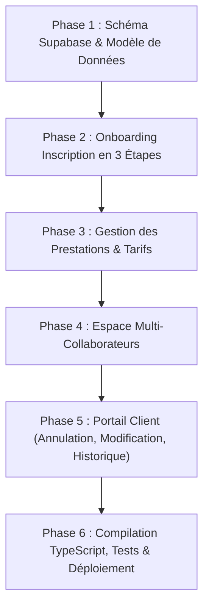
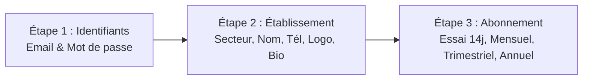
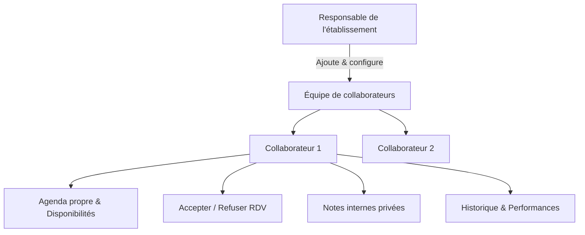

# Plan d'Implémentation Détaillé — Créno v2

## 1. Contexte & Objectifs

Ce plan d'implémentation structure les évolutions majeures de la plateforme **Créno** pour les petites et moyennes entreprises et professionnels indépendants :
1. **Onboarding et Inscription en 3 étapes distinctes** :
   - Étape 1 : Création du compte (email professionnel et mot de passe).
   - Étape 2 : Identité de l'établissement (sélection étendue du secteur d'activité avec saisie libre "Autre", nom du responsable, téléphone, logo ou photo de la structure, description des prestations).
   - Étape 3 : Choix de la formule d'abonnement (Essai gratuit 14 jours, Mensuel à 10 000 FCFA, Trimestriel recommandé à 25 000 FCFA mis en valeur, Annuel à 80 000 FCFA).
2. **Gestion Multi-Collaborateurs (Équipe & Praticiens)** :
   - Consultation d'agenda individuel.
   - Acceptation et refus des demandes de rendez-vous.
   - Gestion des disponibilités et horaires de travail propres à chaque collaborateur.
   - Accès aux informations clients et historique.
   - Saisie de notes internes confidentielles.
   - Suivi d'activité et indicateurs de performance individuels.
3. **Portail de Réservation Client Amélioré** :
   - Grille tarifaire des prestations claire et sélectionnable lors de la prise de rendez-vous.
   - Formulaire dynamique avec questions personnalisées de l'établissement.
   - Annulation et modification autonome de réservation par le client depuis son interface.
   - Séparation claire entre rendez-vous à venir et historique des réservations passées.
4. **Conformité stricte au Point de Vérité Design & Copywriting** (`imperatif/point_de_verite_site_web.txt`) :
   - Zéro emoji dans toutes les interfaces et notifications.
   - Zéro tiret cadratin dans tout le contenu client.
   - Palette de couleurs unie et professionnelle (fond blanc cassé `#f8fafc`, accent bleu pro `#0284c7`, sans dégradé violet/indigo).
   - Textes concrets, spécifiques aux métiers locaux et sans formulations génériques d'IA.

---

## 2. Découpage du Projet en 6 Phases

---

## Phase 1 : Schéma Supabase & Modèle de Données

### Objectifs :
Garantir une persistance robuste, idempotente et sécurisée avec Row Level Security (RLS) sur Supabase pour toutes les nouvelles entités.

### Actions concrètes :
1. **Évolution de la table `profiles`** :
   - Ajout des colonnes :
     - `subscription_plan` (text : `trial_14d`, `mensuel_10k`, `trimestriel_25k`, `annuel_80k`)
     - `subscription_status` (text : `trial`, `actif`, `expire`)
     - `trial_ends_at` (timestamp with time zone)
     - `logo_url` (text)
     - `description` (text)
2. **Nouvelle table `collaborators`** :
   - `id` (uuid, primary key)
   - `user_id` (uuid references profiles(id) on delete cascade)
   - `full_name` (text, not null)
   - `email` (text)
   - `phone` (text)
   - `role` (text default 'collaborateur')
   - `avatar_url` (text)
   - `available_days` (text[] default array['lundi', 'mardi', 'mercredi', 'jeudi', 'vendredi'])
   - `opening_time` (time default '09:00')
   - `closing_time` (time default '18:00')
   - `active` (boolean default true)
   - `created_at` (timestamp with time zone)
3. **Gestion des Prestations / Services dans `booking_configs` & Table dédiée** :
   - Colonne `services` (`jsonb` structuré : `[{ id, name, duration_minutes, price_fcfa, description }]`) dans `booking_configs`.
4. **Évolution de la table `appointments`** :
   - `collaborator_id` (uuid references collaborators(id) on delete set null)
   - `service_price` (integer default 0)
   - `internal_notes` (text)
5. **Règles RLS et Politiques de Sécurité** :
   - Lecture publique sécurisée pour la prise de rendez-vous client.
   - Isolation stricte des données entre les comptes administrateurs et collaborateurs.

---

## Phase 2 : Inscription et Onboarding en 3 Étapes

### Objectifs :
Créer un flux d'inscription par étapes, clair et rassurant, qui guide le nouveau professionnel sans friction.

### Détail des 3 étapes :
1. **Étape 1 : Identifiants d'accès**
   - Saisie de l'adresse email professionnelle.
   - Mot de passe sécurisé (minimum 6 caractères).
   - Validation en temps réel.
2. **Étape 2 : Identité de l'établissement**
   - **Secteur d'activité** via sélecteur :
     - Salon de coiffure
     - Magasin / Commerce de détail
     - Salon de beauté / Institut de soins
     - Pharmacie
     - Cabinet médical / Paramédical
     - Pressing / Blanchisserie
     - Agence de services / Conseil
     - Autre activité (affiche immédiatement un champ de saisie texte personnalisée).
   - **Nom de l'établissement**.
   - **Nom complet du responsable**.
   - **Numéro de téléphone WhatsApp professionnel** du responsable.
   - **Photo ou logo de l'établissement** (facultatif, prévisualisation immédiate).
   - **Description des prestations proposées** (champ de présentation pour informer les clients).
3. **Étape 3 : Choix de la formule d'abonnement Créno**
   - **Formule Découverte (Essai Gratuit)** :
     - 14 jours d'accès complet sans engagement.
     - Prise en main en situation réelle.
   - **Formule Mensuelle** :
     - 10 000 FCFA par mois.
     - Flexibilité mensuelle pour les structures en démarrage.
   - **Formule Trimestrielle (Mise en avant principale)** :
     - 25 000 FCFA pour 3 mois (soit 8 333 FCFA / mois).
     - Économie directe de 5 000 FCFA par rapport au tarif mensuel.
     - Continuité opérationnelle assurée pour le trimestre.
     - Mise en valeur sobre avec bordure accentuée et marqueur distinctif sans cliché IA.
   - **Formule Annuelle (Performance Pro)** :
     - 80 000 FCFA par an (soit 6 666 FCFA / mois).
     - Rentabilité maximale pour les établissements pérennes.
     - Priorité de support et sérénité sur toute l'année.

---

## Phase 3 : Gestion des Prestations et Tarifs

### Objectifs :
Permettre au professionnel de configurer ses services avec leurs prix réels en FCFA, et les afficher de manière transparente pour le client.

### Actions concrètes :
1. **Dans l'espace d'administration (Paramètres de réservation)** :
   - Section dédiée "Prestations & Tarifs".
   - Formulaire d'ajout rapide : Intitulé de la prestation, Durée estimée (30 min, 1h, 2h...), Tarif en FCFA, Description courte.
   - Liste interactive avec modification et suppression.
2. **Dans le formulaire de réservation du client** :
   - Affichage des prestations disponibles sous forme de cartes claires avec le tarif en FCFA visible d'emblée.
   - Sélection en un clic qui pré-remplit la durée du créneau et calcule le montant prévu.

---

## Phase 4 : Module Multi-Collaborateurs

### Objectifs :
Donner à chaque membre de l'équipe son espace opérationnel tout en conservant une supervision globale pour le responsable.

### Fonctionnalités collaborateurs :
1. **Agenda individuel** :
   - Filtrage du calendrier par collaborateur pour afficher uniquement les rendez-vous assignés.
2. **Acceptation / Refus** :
   - Boutons d'action pour valider ou rejeter une demande attribuée.
3. **Disponibilités personnalisées** :
   - Définition des jours d'exercice et des heures d'ouverture / fermeture propres au collaborateur.
4. **Fiche client & Notes internes** :
   - Accès aux informations du client (nom, contact, demandes particulières).
   - Ajout et modification de notes internes confidentielles, non visibles par le client.
5. **Indicateurs de performance** :
   - Statistiques individuelles : volume de rendez-vous gérés, taux de rendez-vous honorés, volume hebdomadaire.

---

## Phase 5 : Portail Client Enrichi (Annulation, Modification, Historique)

### Objectifs :
Offrir au client une autonomie totale sur ses réservations et une visibilité parfaite sur ses antécédents.

### Actions concrètes :
1. **Actions sur les rendez-vous actifs ("Mes rendez-vous")** :
   - Bouton **"Modifier mon créneau"** : ouvre le sélecteur de date et d'heure pour reprogrammer la réservation.
   - Bouton **"Annuler la réservation"** : demande une confirmation sobre, met à jour le statut en `annule` et avertit l'établissement.
2. **Historique des réservations passées** :
   - Section ou onglet dédié regroupant les rendez-vous honorés, passés ou annulés.
3. **Questions supplémentaires personnalisées** :
   - Prise en compte dynamique des questions définies par le responsable dans l'étape de confirmation.
4. **Notifications PWA & WhatsApp** :
   - Déclenchement automatique des messages de confirmation et de mise à jour de statut.

---

## Phase 6 : Validation, Tests & Déploiement

### Actions concrètes :
1. **Compilation TypeScript** (`npm run build`) : Vérification de l'absence totale d'erreurs de typage.
2. **Vérification de la checklist Point de Vérité** :
   - Aucun tiret cadratin dans les libellés client.
   - Aucun emoji dans le code ni dans les interfaces.
   - Validation de la palette de couleurs et du contraste.
3. **Tests de bout en bout** :
   - Parcours complet d'inscription 3 étapes.
   - Création et prise de rendez-vous avec choix de prestation tarifée.
   - Modification et annulation par le client.
   - Assignation à un collaborateur et ajout de note interne.
4. **Synchronisation Git & Déploiement Render** :
   - Commit structuré et push vers la branche `main`.

---

## 3. Décisions à Valider avec l'Utilisateur

Avant de commencer le développement de la Phase 1 et de la Phase 2 :
1. **Stockage des logos / photos** : Préférer l'encodage base64 direct en base ou le bucket Supabase Storage ? (Le base64 direct est immédiatement autonome sans configuration préalable de bucket public).
2. **Accès des collaborateurs** : Doivent-ils avoir un identifiant de connexion dédié (compte Supabase Auth par collaborateur) ou un profil sélectionnable dans l'interface de l'établissement ?
3. **Mise en avant de la formule trimestrielle** : Êtes-vous en accord avec la présentation mettant en avant l'économie de 5 000 FCFA et la continuité sur 3 mois ?
